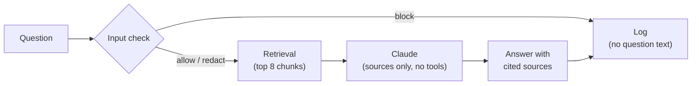

# Wastewater AI Assistant: a governed RAG demo

An AI assistant for wastewater engineers that answers questions from public, current regulatory documents, with governance built in. Every question is screened before it reaches the model: secrets are blocked, client names and personal details are redacted, and sensitive wording is flagged. Answers cite the exact source and page, warn when a source is a draft or more than 10 years old, and every request is logged without ever storing the original question.

Built with Python, a local Chroma vector index, Claude (through Claude Code), and a Streamlit web app.

## Why I built it

Engineering firms want the productivity of AI tools, but they also need to know what leaves the building, what gets stored, and whether an answer can be trusted. I built this to show both halves of that problem working together:

- **Adoption:** a tool engineers would actually use, with fast, sourced answers to permit and regulation questions.
- **Governance:** controls a firm would need before rolling it out, including input screening, privacy-safe logging, traceable citations, and a dashboard showing how the tool is used.

## How it works



- **Question:** the engineer asks in the Streamlit app or from the command line.
- **Input check** (`src/input_check.py`): secrets are blocked, sensitive details are replaced with `[REDACTED]`, and words like "confidential" are flagged. A blocked question goes no further.
- **Retrieval** (`src/store.py`): only the checked text is used to search a local vector index of the documents, split into ~800-character chunks.
- **Claude** (`src/llm.py`): receives the redacted question and the numbered excerpts. The prompt tells it to answer only from the sources, quote numbers exactly, add no unsupported comparisons, and say clearly what the sources don't cover.
- **Answer with cited sources** (`src/rag.py`): only the sources Claude actually cited are shown, with title, page, publisher, date, status, and link. Draft and age warnings are added.
- **Log** (`src/logger.py`): a SQLite record of the decision, reasons, redacted question, sources used, and latency, shown in the Governance Dashboard tab.

## Documents used

| Document | Publisher | Date | Status |
|---|---|---|---|
| [NPDES Permit Writers' Manual (2025 update)](https://www.epa.gov/system/files/documents/2025-09/pwm_2010_edits_2025_06.pdf) | U.S. EPA | 2025-06-01 | Final |
| [Niland WWTP NPDES Permit, Order R7-2025-0017](https://www.waterboards.ca.gov/rwqcb7/board_decisions/adopted_orders/orders/2025/r7-2025-0017-niland-wwtp-npdes-permit.pdf) | Colorado River Basin Regional Water Quality Control Board | 2025-07-01 | Final |
| [California Regulations Related to Recycled Water (Title 22)](https://water.waterboards.ca.gov/drinking_water/certlic/drinkingwater/documents/lawbook/stats-regs.pdf) | California State Water Resources Control Board | 2026-05-01 | Final |
| [Draft Sewage Sludge Risk Assessment for PFOA and PFOS: Information for WWTPs](https://www.epa.gov/system/files/documents/2025-01/fact-sheet-wwtps-draft-sewage-sludge-risk-assessment-pfoa-pfos.pdf) | U.S. EPA | 2025-01-14 | Draft |

**Why only public 2025-2026 sources:** regulations change, and an answer based on a superseded rule can be worse than no answer. Current documents keep the answers relevant. Public documents mean anyone can check an answer against the original, and no client or confidential data is involved. The PFAS fact sheet is deliberately a draft, so the draft warning can be seen working.

## Governance features

- **Block, redact, flag:**
  - **Block** (never sent to Claude): API keys and tokens, passwords (`password:`, `password=`, `password is`), Social Security numbers with or without dashes, and credit card numbers, including 15-digit Amex.
  - **Redact** (replaced with `[REDACTED]`, then answered): client and project names from `data/sensitive_terms.json` in any case or spacing (`Mesa Verde`, `MesaVerde`, `mesa-verde`), dollar amounts (including `$4.5 million`), email addresses, and phone numbers.
  - **Flag** (noted, left in the question): "confidential", "proprietary", "internal only".
- **The original question is never stored.** Only the redacted text is searched, sent, or logged. Blocked requests are logged with no question text. The user name goes through the same check and is logged as `[REDACTED_USER]` if it contains anything sensitive.
- **Token scrubbing:** the Claude credential is removed from any error message before it can reach the log or the screen.
- **Tools disabled for Claude:** Claude runs with no tools, no MCP servers, and no saved sessions, in an empty temporary folder. Text inside a PDF cannot make it run commands or read files.
- **Cited sources only:** the source list shows only what the answer cites, with the original source numbers.
- **Draft and age warnings:** answers that use a draft document, or one more than 10 years old, get a visible warning.
- **Fail closed:** if the sensitive-terms list is missing or invalid, every question is blocked rather than sent unredacted. If the index is missing, the app says how to build it instead of failing silently.

## NIST AI RMF mapping

How the project lines up with the four functions of the [NIST AI Risk Management Framework](https://www.nist.gov/itl/ai-risk-management-framework):

| Function | In this project |
|---|---|
| **Govern** | Written rules for what is blocked, redacted, and flagged; a maintained sensitive-terms list; a rule that the original question is never stored; fail-closed defaults |
| **Map** | A narrow use case (public wastewater regulations); every document recorded with publisher, date, and draft/final status; known tradeoffs written down |
| **Measure** | 49 automated tests; a 6-question evaluation set with expected answers; a dashboard tracking decisions, latency, and document use |
| **Manage** | Blocking and redaction before the model; tools disabled; citations and warnings on every answer; clear errors when Claude times out or fails |

## Testing and evaluation

**49 pytest tests**, all passing, with Claude and the index replaced by fakes so the tests are fast and free:

- **Input check (29):** each block, redact, and flag rule; flexible name matching; normal permit text (such as `Order R7-2025-0017`) staying allowed; blocking when the terms file is missing or invalid.
- **Governance (12):** the original question never reaches search, Claude, or the log, whether the question is redacted, blocked, or fails; only cited sources are kept; sensitive user names are redacted.
- **Claude call (4):** the token never appears in an error; timeouts, empty replies, and a missing token are reported clearly.
- **Log and index (4):** blocked events store no text; telemetry is off; a missing index gives a clear error.

**Evaluation** (`eval/run_eval.py`, results in `eval/results.md`): six real questions run against Claude, covering a definition, Niland permit limits, Title 22 turbidity limits, the EPA PFAS findings, and two off-topic questions that should get "I couldn't find that in the available documents."

**A real finding:** in an early run, the Niland answer listed the BOD5 limits of 45/65 mg/L correctly, then called them "more stringent" than the 30/45 mg/L secondary treatment standards. That is backwards, and no source said it. The prompt was tightened so Claude adds no comparisons or conclusions the sources don't state, quotes numbers exactly, and says what the sources don't cover. The answer now reports the limits and their regulatory basis with nothing added. Tuning this also showed the opposite failure: a prompt that is too strict made Claude refuse a question the sources partly answered, so the prompt now separates "nothing relevant" from "partly answered".

## Known tradeoffs

The input check favors safety over convenience, so it has false positives:

- "What password is required for SCADA access?" is blocked, because it looks like `password is <value>`.
- Any 9-digit number is blocked as a possible Social Security number.
- Any 10-digit number is redacted as a possible phone number.

Retrieval has limits too. Long PDFs are split into text chunks, and tables can lose their structure or be split across chunks. A specific number in a large table may not be found, or may come back without its row or column label.

## Setup and run

Tested with Python 3.14. Requires [Claude Code](https://docs.claude.com/en/docs/claude-code) with a Claude subscription.

```bash
python3 -m venv venv
source venv/bin/activate
pip install -r requirements.txt

# Create a long-lived token for Claude Code and save it in .env (git ignores .env)
claude setup-token
echo "CLAUDE_CODE_OAUTH_TOKEN=<your token>" > .env

# Build the document index (the first run downloads a small local embedding model)
python src/store.py

# Start the web app
streamlit run app.py

# Run the tests and the evaluation
pytest
python eval/run_eval.py
```

You can also ask a single question from the command line: `python src/rag.py "What are the BOD5 limits for Niland?"`

## Auth note

This demo runs locally on a personal Claude subscription through Claude Code, for single-user demo use only. For multi-user or hosted use, switch `src/llm.py` to an Anthropic API key. It is the only module that talks to the model, so it is the only file that needs to change.

## Future improvements

- **Project documents with role-based access control:** add internal project files while making sure each engineer can only retrieve documents they are cleared to see.
- **Hybrid keyword + vector search:** combine exact-term matching with semantic search, so permit numbers, section numbers, and table values are found reliably.
- **Enterprise integration:** read sensitivity labels from tools like Microsoft Purview, so a document's existing classification decides whether it can be indexed or sent to a model.

## Disclaimer

This is a personal portfolio project. It is not affiliated with or endorsed by any employer. It uses only public documents and contains no client data. The client and project names in `data/sensitive_terms.json` are fictional examples used to demonstrate redaction. Answers are for demonstration and should be checked against the original documents.

---

Built by **Jimmy Thomas** · [GitHub](https://github.com/jimmyytthomas) · [LinkedIn](https://www.linkedin.com/in/jimmy-thomas-87a9521bb)
